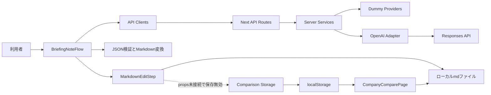
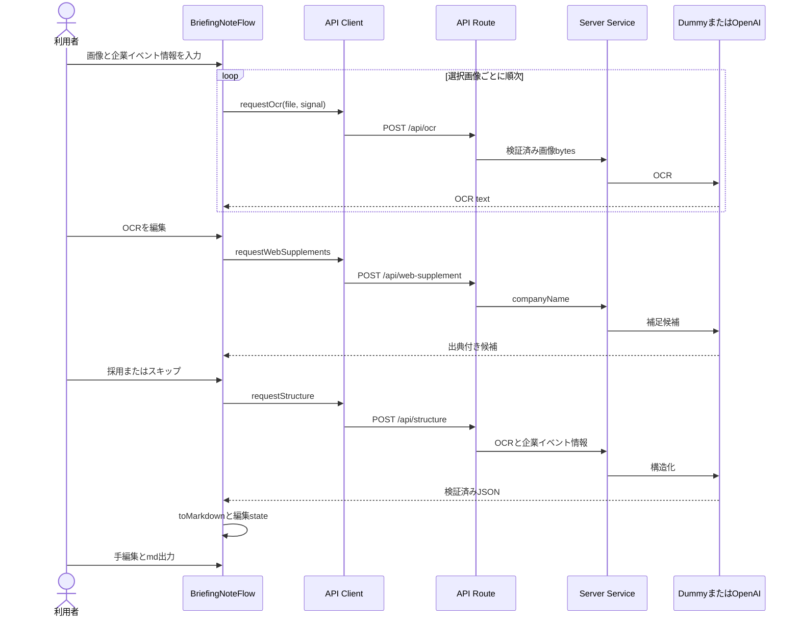
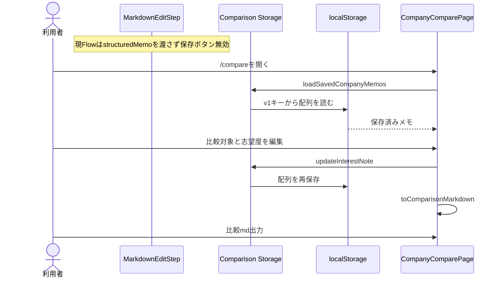

## Architecture Analysis

### System Overview
Next.js App Router単一アプリ。サーバーpage/layoutがclient Flow/比較画面を配置し、ブラウザは自アプリAPIを呼ぶ。API RoutesはサーバーserviceとOpenAIアダプター/dummyを利用する。`app/page.tsx:1`, `app/compare/page.tsx:1`, `src/lib/server/openaiClient.ts:34`。

### Architectural Style
フロントとAPIが同じnpm packageにあるモノリス。永続サーバーストアや独立サービスはない。Vercelでの実際の稼働設定/デプロイは未確認。Dockerはnode:22-alpineの開発サーバー構成（`Dockerfile:1`）。

### Component Relationships

テキスト代替: Flow→client→API→service→dummyまたはOpenAI。検証済みJSONからMarkdownを作り編集/出力する。比較はlocalStorageを読む。保存関数/ボタンは存在するがFlowからstructuredMemoが渡らず通常導線で無効になる。

### Data Flow
画像File/blob URL、OCR、structuredMemo、編集Markdown、Web採否、復習結果はFlowのReact stateに保持。画像変更で派生結果をクリアし、unmount時にURL/一部requestを解放する。`src/components/BriefingNoteFlow.tsx:28,78,95`。
生成Markdownは元画像名とOCRテキストを含む。画像バイナリは永続化しないが、比較の保存MarkdownにはOCR/採用Web情報が含まれ得る。SavedCompanyMemoは構造化メモ、Markdown、志望度、savedAt/updatedAtをlocalStorageに保存する。OCR/Web/復習の個別再利用可能な構造は保存モデルにない。`src/lib/structure/toMarkdown.ts:67`, `src/lib/comparison.ts:9`。
手編集MarkdownからJSONに反映する処理はなく、比較/復習はstructuredMemoを使う。編集後本文と派生出力の差を管理する必要がある。

### Key Design Decisions
相対importとnamed export中心、UI/controller、client HTTP、server service、検証/変換を分離。秘密キーはserver env、browserへの返却なし。ZodとJSON SchemaでLLM出力を検証し、Webは採用項目だけ独立sectionに出す。
localStorageは端末/ブラウザorigin単位でユーザーIDを持たない。会社・イベントの親子モデル、選考状態、認証/ユーザー分離はまだない。APIのauth/rate-limit middlewareも見つからない。`app/api/`, `src/lib/comparison.ts:69`。

### Improvement Opportunities
企業単位のidentity、複数メモと編集データの継承、進行中社数の定義、保存先と分離境界を次の要件/設計で決める。既存API/provider、カテゴリ分離、出典の保持を変更面として把握する。本書は最終DB/providerを選定しない。

## Interaction Diagrams

テキスト代替: 画像ごとにOCRし連結、OCRを修正、Web候補の採否、構造化JSON生成/検証、Markdown編集/ダウンロード。Web無効/企業未特定は空候補として継続。その他取得エラーのUI問題は品質評価参照。

テキスト代替: 比較ページは既存localStorage配列を読み、選択メモの志望度/理由を更新し比較mdを作る。生成画面の新規保存はprops欠落のため無効。これはソース所見であり今回ブラウザで再現していない。両図はflowchart/sequenceDiagram構文を目視確認した。
