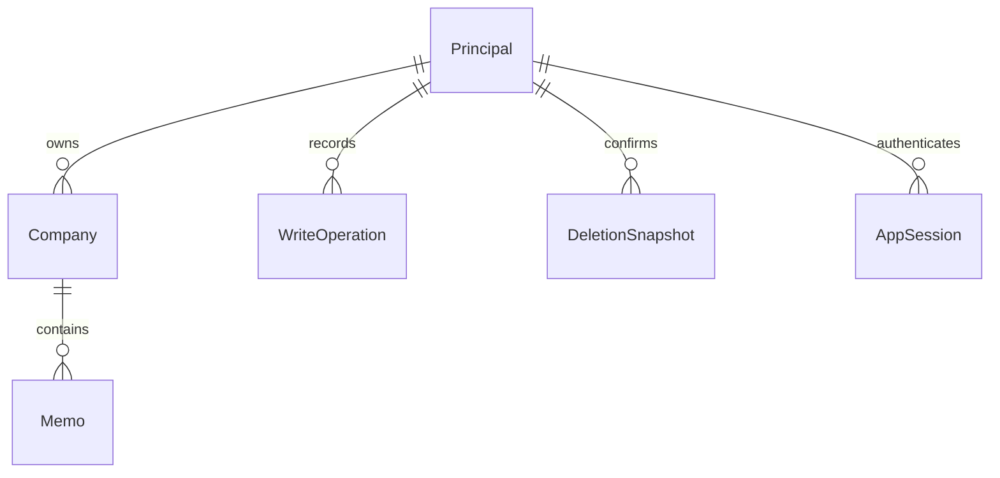

# U1：本人確認と企業・メモ管理の動作仕様

## Scope and Authority

本書は操作順序と画面状態遷移の正本。データ形状はentities.md、判断規則はrules.mdのYAMLを正本とし、下記の関係図・規則要約は派生表示とする。U1はAccessControl／CompanyWorkspaceと共通・管理画面を担当する。U2の画像・生成接続とU3の比較画面の完成は、この設計だけで受入済みとしない。

functional-design-questions.md Q1の本人回答aにより、構造化項目なしの手入力メモへ「比較用項目を追加」の明示操作を用意する。これは既存のManualCandidate.structuredContentとUpdateMemo.changesを使う本人編集の具体化。FR6.1の自動構造化禁止、FR7の別正本、C2/C3の有効構造条件を保ち、要件・契約・90 ACは変更しない。空の編集枠を開いたことだけでは保存を行わない。

設計文書を作ることとアプリ実装開始は区別する。導入PR #100の人間マージ／対象SHA公開確認、更新main、専用サービス・本人／鍵／接続、後続詳細設計とコード計画承認の着手条件はbolt-plan.mdから維持する。今の文書はその達成証拠ではない。

## Derived Entity Relationships

テキスト代替: 本人1人に企業0〜複数、企業1件にメモ0〜複数。操作結果・削除確認・内部セッションは各本人に属する。対象を削除しても操作結果を消さない。EditDraftは端末の一時入力であり永続所属を持たない。

## Workflows

### WF1 — 本人ログイン・読取・ログアウト

1. 初回と再表示で認証状態を確認し、確認中に保護内容を表示しない。ログイン入口と公開healthは企業データを返さない。
2. 本人が管理側で用意したemail／passwordを入力する。ログイン失敗は再試行を示し、企業0件表示へ移さない。
3. 認証依存先で本人を検証し、内部セッションを確定して安全なCookieを返す。password・Auth tokenをUIへ保存／返却しない。
4. 全保護要求で失効・絶対7日／非操作24時間・Authの本人を確認する。読取と書込の対象所有者を照合し、応答は保存正本から作る。refreshは同一セッションで直列化する。
5. ログアウトは未保存入力の破棄確認を先に解決してから現在のセッションを失効。外部Authの失効成功に依存せず、確定応答後に成功とする。
6. UIは要求世代を変え、保護内容／比較キャッシュと遅延応答を除く。401も同じ境界を閉じる。失効中のdraftは表示せず端末の一時領域へ隔離する。
7. 同じ本人の再認証後だけ最新保存版を取得してdraftを再編集できる。他本人に表示／自動保存しない。ページ終了を越える完全復元は保証しない。

セッション確認／ログイン／ログアウトの経路とCookie条件はbolt-planのSession Boundaryに従う。変更Origin検査と本人検査の両方が必要。セッション確認のストア障害と認証なしを混同せず、依存先を検証できないまま保護内容を返さない。

### WF2 — 名前だけの企業登録と企業情報更新

1. ボードの追加操作で登録dialogを開き、名前欄へfocus。新規companyIdとoperationIdを1回の意図に対して用意する。
2. 名前を検証し、任意欄は未指定、状態は未応募。同名企業があっても統合しない。
3. 本人・Origin・入力と操作IDを検査し、同じ操作が確定済みなら元結果を返す。未確定の同時要求は一意キーで直列化する。
4. 企業作成と操作確定結果を一つの原子的変更で保存する。失敗なら両方を確定しない。
5. 保存確定後に詳細とボードを再取得。再取得失敗では「保存確定・表示の再取得失敗」を示し、登録を新操作で勝手に繰り返さない。
6. 企業更新では保存版をbaselineにし、本人が変更した許可項目だけ送る。日付は暦日、任意空欄はnull。名前変更でも所属IDを保つ。
7. 同じ親を直列化しexpectedVersionを照合、変更と新しい版と操作結果を同時確定。競合はWF6へ、通信途絶はWF5へ。
8. Escape／取消は保存を伴わない。dirtyな登録を閉じる際は破棄確認、取消で入力へ戻る。確定作成後だけ同じ企業の詳細へ移動する。

### WF3 — ボード・状態・対応中社数

1. 本人の8状態の企業から一つの読取スナップショットで軽量カードと全状態の件数を作る。本文はカード一覧へ載せない。
2. 各企業をIDで1回だけ表示し、通常は未応募／検討中／応募済／書類選考／面接／内定の6列。辞退／不採用は表示toggleで追加する。
3. savedCompanyCount=0は保存0件、savedCompanyCount>0かつvisibleCompanyCount=0は表示対象0件。失敗・読込中はどちらにも確定しない。
4. activeCompanyCountは応募済／書類選考／面接だけを企業IDで数える。目標5〜15社、15以上だけ文字付き警告。0／4／5／14は警告なし、16社目の操作は許可。
5. 状態選択から8状態間の変更を本人が明示保存する。順番の強制はしない。途中の選考継続は同じ対応中状態に留める。
6. 保存確定後にカード・状態件数・社数を同じ取得結果で更新。終了状態でカードが隠れても成功通知と再表示入口を示す。
7. 表示toggleは読取表示だけを変更し社数・データ・警告を変更しない。古い取得応答は要求世代で破棄する。
8. 次の選考日は独立領域の明示ラベルと補助項目より大きい太字。未設定は文字、締切は別項目。日付を端末時差で動かさない。

PCの列領域スクロールと移動ボタン、スマホの縦グループ、終了toggleのfocusと通知はinteraction-specに従う。各列内の表示順はupdatedAt降順、同時刻はcompanyId昇順で安定させる内部既定とし、並べ替え機能は追加しない。

### WF4 — 所属メモの追加・編集・本文出力

1. 同じ企業の詳細でメモ一覧を取得する。本文なし、既定20／最大100件のページ。updatedAt降順とmemoIdの安定順、不透明cursorは本人と企業へ結び付ける。
2. 画像なしの手入力では本文を入力し、空白のみを拒否。初期structuredContentはnull、providerOriginはnull。画像／OCR処理は呼ばない。
3. 「比較用項目を追加」は本人が押した時だけ全項目の空の編集枠を開く。既存overviewの4文字欄と10配列を保持し、空配列／空文字を架空値で埋めない。
4. 本人の入力から全項目の形・長さ・配列数・出典を検証する。保存済みnullと未保存の編集枠を区別し、明示保存するまで比較適格としない。空だが有効な構造は「未記載」の比較元になり、nullは「構造化項目なし」となる。
5. 作成では同じ親の存在と本人を保存時に確認し、メモ作成・企業子集合版更新・操作結果を原子的に確定。生成候補も同じ保存処理を使い、出自証明・構造・出典を検証する。生成候補作成と画像解放の画面はU2。
6. メモを開くと本文／比較用項目／原文・出典を別領域で表示。本文の変更で構造化項目を、項目変更で本文を自動生成しない。企業志望度は企業正本、比較理由は選択メモ、自由企業メモと混同しない。
7. 編集保存は選択memoIdのexpectedVersionを照合し、明示変更だけを確定。生成由来メモも同じ編集で、origin／providerOrigin／companyIdを変えない。全項目の編集でもchildrenVersionを更新する。
8. 保存後の再取得を基準にsaved状態へ移る。再取得失敗は入力と確定結果を保持し、新しい作成を繰り返さない。別端末の明示再取得でも同じIDと保存値を読む。
9. 本文の.md出力は今表示／編集している本文と同じ文字列。未保存ならその区別を表示し、出力を保存成功扱いにしない。紙由来とWebの本文区分・URL・取得日を失わず、別正本の比較項目を本文へ自動合成しない。

本文／プレビューと本文／比較用項目／原文出典tabsは切替だけで破棄・保存しない。Markdownの危険なHTMLやスクリプト風文字は実行せず、資格情報なしのhttp/httpsだけをリンク化する。非常に長い語も折り返し、検証エラーは対象欄と要約で示す。

### WF5 — 二重送信と結果不明

1. 送信開始時に検証済みの要求とoperationIdを固定し、二重送信をUIでも抑制。
2. サーバーは本人＋operationIdで要求SHA-256を照合。検証後の型、キー安定順、配列順維持、nullと未指定の区別を含める。
3. 同じ操作・同じ要求は元のMutationOutcomeを返す。内容違いは409 operation_reused。対象の存在／削除確認期限の検査より成功再送の照合を先にする。
4. 応答途絶／保存依存先から確定不能ならunknownとし、成功・ロールバックを断定しない。入力と同じ要求を保持する。
5. 本人が結果確認するとoperationsで照合。committedなら最新対象を再取得する。元の版を現在値とみなさず、後続編集や削除を表示する。
6. unknownは「未実行確定」ではない。本人が再試行を選んだ時だけ同じ要求／operationIdで送信。別内容へ変える前に旧操作の結果を確認する。
7. 新APIはブラウザ15秒／処理10秒／保存全体8秒、取消し・後始末を含む。GETのネットワーク失敗／503だけ500ms後1回、その他と書込は自動再送なし。無限pollingなし。
8. 対象削除後も成功操作は本人保存領域が続く間保持し、作成済みIDを再利用しない。操作記録に本文・OCR・完全要求を複写しない。

### WF6 — 古い版からの更新と未保存保護

1. 最新を取得したbaselineと編集draftを分ける。別クライアントが先に保存すると、古いexpectedVersionの更新は変更なしで409。
2. 最新取得と保持入力を別に表示し、自動合成／再送しない。最新取得失敗のまま旧版を成功扱いしない。
3. 本人が最新の変更を確認して再編集・新しい明示保存を選ぶ。新しい意図にoperationIdを発行し新baselineで保存する。
4. アプリ内移動／ログアウト／対象切替でdirty入力を破棄する前に確認。取消なら編集継続。対応ブラウザの離脱確認も使用するが強制終了後の完全復元は約束しない。
5. 保護内容は401で非表示にし、本人復帰以外の経路へdraftを渡さない。

### WF7 — 版と所属集合を確認した削除

1. 単体メモなら対象企業と対象1メモ、企業なら企業名と正確な全所属件数を一貫した読取で確認する。ページ内件数で代用しない。
2. 企業版・全メモIDと版・内部子集合版を含む確認を作り、有効10分のconfirmationIdを返す。確認作成は削除ではない。
3. dialogの初期focusは取消。取消／Escape／背景操作は削除せず、focusを戻す。
4. 本人の確定操作でoperationIdとconfirmationIdを送る。同じ確定済み操作なら元結果を返す。
5. 新しい削除は本人と期限を確認し、企業を先に直列化して対象版と集合を再照合する。対象確認と変更を分離しない。
6. 企業・メモの追加／編集／削除や同数の入替／理由編集があれば変更検出で停止。最新の対象・件数・変更を示し、新しいconfirmationIdで本人が再確認する。最新取得失敗中は実行不可。
7. 既に対象不存在ならその状態を本人へ案内し、他対象へ置き換えない。同操作の成功再送とは区別する。
8. 単体は該当1メモと子集合版、企業は全所属メモと企業を原子的に削除し操作結果を確定。途中失敗では部分削除を残さない。
9. 確定後にボード・社数・詳細・候補を再取得して対象参照を無効化。起動ボタンが消えたら一覧見出しへfocus。旧localStorageは変更しない。U3の比較結果／出力も参照失効を検出する。

## State Transitions

| 対象 | 状態／起点 | 操作・結果 | 次の状態 |
|---|---|---|---|
| セッション | 確認中／未認証 | 本人検証・内部保存が確定 | 認証済み |
| セッション | 認証済み | 失効・期限・401 | 再認証待ち、保護内容非表示 |
| 編集 | clean／saved | 本人の入力変更 | dirty |
| 編集 | dirty | 検証成功し明示保存 | saving |
| 編集 | saving | 変更確定・再取得成功 | saved、新baseline |
| 編集 | saving | 欄検証／明示拒否 | rejected、入力保持 |
| 編集 | saving | 応答途絶・確定不能 | unknown、要求保持 |
| 編集 | saving | 旧版409 | conflict、入力保持 |
| 編集 | unknown | 操作確定確認＋最新取得 | saved／最新との再編集待ち |
| 編集 | conflict | 最新確認後の本人再編集 | dirty、新baseline |
| 削除 | 確認取得中 | 有効snapshot取得 | 確認待ち |
| 削除 | 確認待ち | 本人の確定送信 | 送信中 |
| 削除 | 送信中 | 確認変更／期限切れ | 最新取得・新確認待ち |
| 削除 | 最新取得中 | 取得失敗 | エラー、確定不可 |
| 削除 | 送信中 | 原子的削除確定 | 削除済み |
| 削除 | 送信中 | 応答途絶 | unknown、WF5 |

選考状態は8値の任意明示変更。終了状態も削除ではなく、再表示／別状態への明示変更を許す。状態と表示toggleは別の状態機械。

## Frontend Responsibilities and Integration

| 役割 | 入力・状態 | 操作と境界 |
|---|---|---|
| 認証入口／共通移動 | 認証確認状態、要求世代、dirty有無 | session確認・login/logout、本人変更で保護cache破棄 |
| ボード／カード／社数 | BoardSnapshot、showEnded、loading/error | 登録dialog、企業IDの詳細、終了表示toggle |
| 企業フォーム／状態選択 | 保存Company、baseline、draft、欄エラー | C4の企業作成／更新、版競合と結果確認 |
| 企業詳細／メモ一覧 | companyId、本文なしのページ、正確な所属件数 | C4一覧／詳細、手入力・画像生成・削除入口 |
| メモ編集／構造化項目／出典 | memoId、draft各正本、版、dirty/save状態 | C4明示保存、手入力の項目追加、本文出力 |
| 保存状態／競合／削除dialog | pendingOperation、latest、snapshot／期限 | C4操作照合・削除確認／確定、入力保護 |

共通階層は認証境界→ナビゲーション→ボード／企業詳細→企業フォーム・所属メモ編集。通知／競合／確認は対象操作に付属する。UIだけで権限・版・削除整合性を決定しない。

C1の本人コンテキスト、C2の保存先確認とgenerated/manual作成、C3の比較参照・企業志望度／メモ理由更新、C4の正式なルート・HTTP・要求・応答、C6の公開healthをそのまま用いる。C3の比較参照は1〜20社、各社1有効構造化メモ、所有者と所属を照合し選択順の1スナップショットで返す。構造化なし・不正・未認証を有効な比較として返さない。

U2はC2へ検証した候補を渡す。U1は画像解放やOCRの成功を単独で証明しない。U3はC3で読取・明示更新し7観点と参照版を表示、出力前に再取得して版変更・削除を検知し出力を止める。U1はその保存／読取条件を提供する。既存生成／復習の認証接続とHTTP例外はbolt-planに従い、本来の生成・復習処理は維持する。

## Derived Rule Summary and Acceptance

- BR1.1: 全保護操作は検証した本人と対象所有者を照合する
- BR1.2: ログアウト・失効で保護表示と古い応答を無効化する
- BR1.3: 変更要求は同一Originと秘密のサーバー保持を守る
- BR2.1: 企業名だけで未応募の企業を作り、名前では統合しない
- BR2.2: 企業項目・暦日・URLを検証して明示更新する
- BR2.3: 企業自由メモ・企業志望度・各メモの理由は独立する
- BR3.1: 8状態を保存し通常は6状態だけを表示する
- BR3.2: 読込・保存0件・表示対象0件・取得失敗を区別する
- BR3.3: 主要操作はPC・スマホ・キーボードから到達でき、選考日を強調する
- BR4.1: 対応中は応募済・書類選考・面接の企業IDだけを数える
- BR4.2: 目標5〜15社を示し15社以上だけ警告する
- BR5.1: 保存メモの構造・情報区分・出典・出自を検証する
- BR5.2: 原画像を保存モデルへ含めない
- BR6.1: 同じ企業に手入力メモを明示作成して再取得する
- BR6.2: 本文と構造化項目を別々に明示保存する
- BR6.3: 未保存入力・結果不明・破棄確認・安全な本文出力を維持する
- BR6.4: 旧版の更新を原子的に拒否する
- BR6.5: 同じ書込要求は一度だけ確定し結果不明を照合する
- BR6.6: 削除は本人が確認した対象・版・子集合だけへ適用する
- BR6.7: 削除後の参照を無効化し旧ブラウザ保存を変更しない
- BR8.1: 比較へ本人の各企業1つの有効な保存メモを返す
- BR9.1: 既存の生成・復習・出力を本人確認後に維持する
- BR10.1: 項目上限と有限要求時間を超えて切り詰め／再送しない

traceability.jsonはU1の主担当と共同確認条件を個別IDで追跡する。OKは「本設計の規則へ対応した」だけで実装合格ではない。U2／U3で必要な画面・生成・比較出力はDeferredとして担当を明記する。同じACにU1の提供規則がある場合でもリリース全体の統合証拠が必要。

受入の主な反例: 未認証・他所有者、空白名・同名・危険URL・閏日、0/4/5/14/15/16社、終了企業だけ、本文だけの編集、manualへの項目明示追加、全項目空の有効構造とnull、古い版、同じIDの別内容、確定直後の応答断絶、削除確認後の同数メモ編集、部分失敗、対象削除後の再送、失効後の遅延応答。SQLの原子性は実アダプタの結合試験、画面は承認済みPC／スマホ・拡大・キーボード条件で検証する。今はアプリコード／依存／migrationを作らない。

## Assumptions & Open Questions

Q1は回答済み。上記の列内安定順は内部表示既定であり機能・保存順の変更ではない。専用認証・保存環境、DB版／リージョン、鍵管理・権限・取消しとrefresh失効競合の実現、無料枠と性能の実測、導入Boltの公開確認は後続着手条件として残る。未準備を成功扱いせず、成立しなければ実装前に相談する。

## Sources

- ../../../inception/units-generation/unit-of-work.md、unit-of-work-story-map.md — U1責任と共同受入。
- ../../../inception/requirements-analysis/requirements.md — FR1〜FR9、NFR1〜NFR7。
- ../../../inception/domain-design/components.md — AccessControl、CompanyWorkspace、ApplicationExperienceの所有権。
- ../../../inception/contract-design/contract-summary.md — C1〜C6の値・正本・再試行・削除契約。
- ../../../inception/delivery-planning/bolt-plan.md — 保存項目、制限、認証期限、検証・着手条件。
- ../../../inception/user-stories/stories.md、../../../inception/refined-mockups/interaction-spec.md — 受入条件と画面操作。
- functional-design-questions.md Q1の本人回答a — 手入力メモへ本人が構造化項目を追加する入口。

