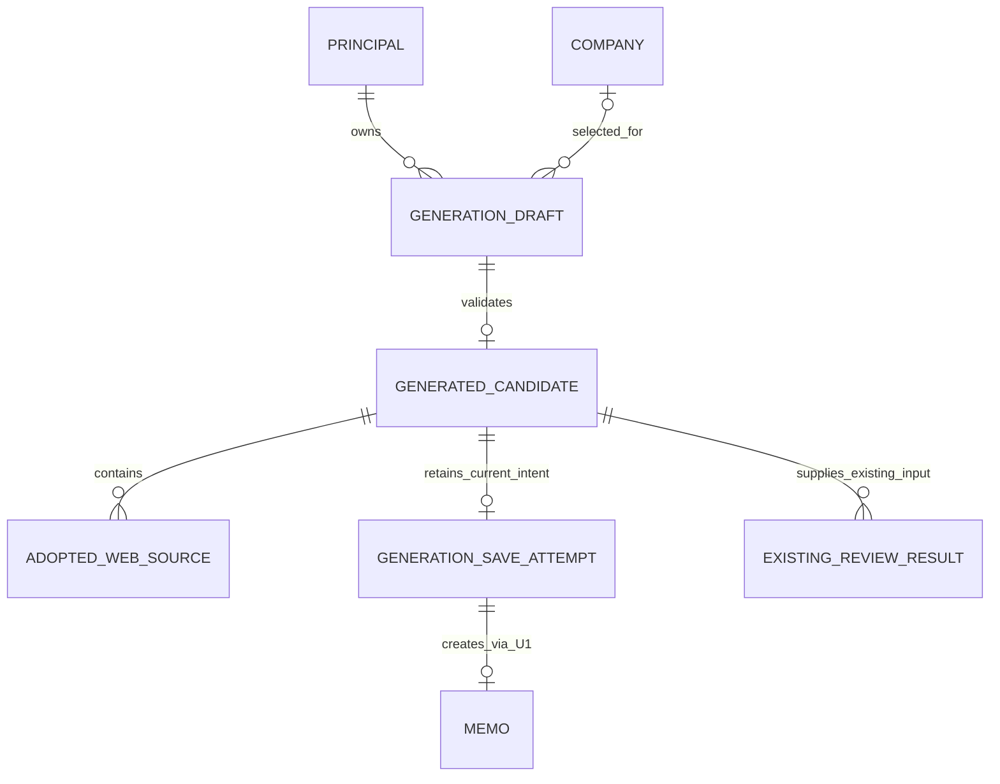

# U2 — 訂正OCR・生成候補から企業メモへの保存

## Scope and Boundaries

本書を処理順と状態遷移の正本とする。データ形はentities.md、判断はrules.mdが正本。U2はMemoGenerationと既存生成画面の接続を所有し、本人認証・企業／メモ保存はU1のC1／C2／C4へ依頼する。独自DB・企業複製・新しい復習永続保存は作らない。U3の比較は保存された構造・出自・出典を参照する後続処理。

現在の実設定待ちはローカル設計／実装の停止条件にしない。実Supabase／Auth・公開確認は未確認のまま保持し、Vercelは本人担当。新しいコード計画承認なしで実装へ移らない。

## WF1 — 対象選択と画像・訂正OCR

1. 認証済み本人が企業詳細から生成を開始し、企業IDと表示名を作業へ固定する。従来の保存先なし単発生成も残す。この場合は保存を無効にして企業から開始する導線を示す。
2. 既存制約の画像を一時入力し、画像を見ながらOCRを実行する。読取中・失敗・成功を区別し、生成や保存成功とは表示しない。
3. OCR成功後、元画像と訂正欄を並べて確認する。本人が訂正OCRとイベントを編集し、明示操作で生成へ進む。
4. 各要求に本人・作業世代・入力snapshotを結合する。画像差替えや取消し後の古い結果は現在の訂正／候補を上書きしない。複数画像は既存順序・訂正入力を維持する。
5. 画像は除去・差替え・保存確定・明示終了時に不要な参照を解放する。保存失敗で訂正を消さず、再生成のため必要な画像は一時保持する。端末メモリだけで、再読込を越える復元は約束しない。

## WF2 — 検証済み候補の確認と編集

1. 生成開始時の訂正OCR・イベントから既存構造を作る。成功を返す前に全項目と型を検証し、その後Markdown候補へ変換する。
2. 構造検証失敗・provider失敗・期限切れなら保存可能な成功候補を作らず、最後の有効候補と入力を保持して修正／明示再生成へ戻す。
3. 有効候補には実際のproviderOriginと本人に結合した出自証明を付ける。dummy表示は生成時・保存・再取得で維持する。クライアントが出自を変更してもU1へ通らない。
4. 選択企業名と生成名が違えば両者を明示する。生成名は候補のoverviewだけで、保存先・企業名・企業数を変えない。
5. 本人が本文・構造・訂正OCR・イベントを確認し、Web候補から採用項目を選ぶ。本文と構造の片方を編集しても他方を自動再生成しない。入力編集後に再生成する場合は、現在の未保存候補を置き換える確認を行う。
6. Webは別領域に出典URL・取得日時・採用状態を示す。採用項目に必要出典が欠ければ保存不可。根拠のない数字や空項目は要確認／未記載として扱う。

## WF3 — 明示保存・結果確認・再取得

1. 本人が「選択企業へ保存」を押す。対象と有効候補・全入力上限を確認し、operationId／memoIdを新しい意図に一度割り当てる。
2. 送信snapshotを固定し、画像を除いたC2候補を同じ企業へ渡す。保存先の存在・所有権と証明はU1が保存時に再検査する。生成中に企業が削除されていれば入力保持で停止し、他企業へ自動保存しない。
3. 保存中は二重実行を抑止。明示拒否は欄別・対象別の修正方法を表示し、候補を保持する。要求を変更して新しい保存をするのは本人の新しい明示意図であり、同じoperationIdへ別内容を送らない。
4. 応答が途絶した場合は結果不明とし、現在入力と送信snapshotを保持する。操作照会がcommittedなら元の成功を確認し、unknownなら未実行と断言せず本人の再試行で同じ要求・operationId・memoIdを使う。自動書込再送・無限pollingなし。
5. 成功確定は保存済みと表示し画像を解放。U1の同じ企業・memoIdを取得し、本文・構造・訂正OCR・イベント・採用Web・出自を確認する。成功後GET失敗は「保存確定、再取得失敗」と区別して再取得可能にする。
6. 保存メモの編集はU1の画面・版契約に渡す。旧版競合時は入力とbaselineを残し、最新の保存内容を別に表示してから明示再編集する。保存送信後に候補を編集した内容も、同じmemoIdへの未保存変更として渡し、別のメモ作成で代用しない。

## WF4 — 認証・未保存移動・既存出力

1. 未保存の訂正／候補があるアプリ内移動は破棄確認し、cancelで現在入力・対象を保持する。対応ブラウザの離脱確認も用い、再読込後の復元は保証しない。
2. 401／logout時は保護結果・キャッシュと遅延応答を排除する。一時入力は同じ端末・本人だけへ保ち、別本人に再表示しない。同一本人の再認証後に対象と保存状態を最新確認してから明示再操作する。
3. 生成／編集候補は現在表示のMarkdownを出力し、保存済みか未保存かを維持する。復習は従来生成入力から従来入口へ進み、対応結果を出力する。新DBメモを復習へ読む連携や結果保存は追加しない。
4. HTML風文字は実行せず、出典は安全なリンクとして表示する。生成出力と復習出力を取り違えず、古い作業の成功結果を新作業として出さない。

## State Machines

| 対象 | 元の状態 | 契機 | 次の状態／保持 |
|---|---|---|---|
| 作業 | input | OCR開始 | ocr_pending／画像と作業世代を固定 |
| 作業 | ocr_pending | 成功／失敗 | correction／input。失敗を空OCR成功にしない |
| 作業 | correction / candidate | 明示生成と必要な破棄確認 | generation_pending／前の有効候補と訂正保持 |
| 作業 | generation_pending | 検証成功／失敗 | candidate／generation_failed。失敗は保存不可 |
| 作業 | generation_failed | 本人訂正・再試行 | correctionまたはgeneration_pending |
| 作業 | 各状態 | 明示終了／本人不一致 | cancelled／要求を無効化、不要画像解放 |
| 保存 | ready | 明示保存 | saving／送信snapshot・安定ID固定 |
| 保存 | saving | 成功確定／拒否／応答途絶 | saved／rejected／unknown |
| 保存 | unknown | 本人の結果確認 | verifying |
| 保存 | verifying | committed／unknown／照会失敗 | saved／unknown／unknown。未実行と推測しない |
| 保存 | unknown | 本人再試行 | saving／同じ要求・ID |
| 保存 | saved | 再取得失敗 | savedのまま再取得エラーを表示 |
| 保存 | rejected | 本人が修正し新規保存 | 新しい保存意図のready。旧要求を改変しない |
| 保存 | saving / unknown / saved | 同じ候補でOCR確認・既存復習を開閉 | 元の状態・安定ID・凍結要求・確定を保持。追加の保存要求なし |
| 保存 | saved | 候補の編集表示・未保存変更 | savedの確定は保持。同じ保存メモへ未保存入力を渡す |
| 候補 | 有効候補あり | 明示的新生成が検証成功／失敗 | 成功した次候補だけが新しい保存意図を持つ。失敗は前候補の確定を保持 |

## WF5 — 保存後のOCR・既存復習への往復

1. 本人が確認した候補を同じ選択企業へ一度保存し、確定したmemoIdと再取得結果を表示する。保存確定は作業全体に属し、表示中の保存欄だけに依存しない。
2. 同じ候補でOCR確認へ戻り、最後の生成候補へ戻っても、確定表示と同じ保存メモを開く導線を保つ。本人の編集は未保存の差分として区別し、新しいメモ作成操作を再提示しない。
3. 従来の面接前復習を生成・表示して閉じても同じ候補と保存意図へ戻る。復習結果の新しい永続保存や、保存DBからの復習入力を追加しない。
4. 保存応答が保留中なら元の一つの要求を追跡し、往復後の応答で同じ確定を示す。結果不明なら同じ要求の照会と本人の再試行だけを許す。表示切替を自動再送の契機にしない。
5. 同じ企業の所属メモ一覧を再取得し、同候補の保存に対応するメモは1件であることと、同じmemoIdの内容を確認する。別の生成候補を明示的に作って保存した場合は、その新しいメモと区別する。
6. 本人・企業の切替または作業終了では旧要求を無効化し、旧確定・通知を別対象へ移さない。新しい生成に失敗しただけなら、元の候補と確定を保持する。

## Derived Entity Relationship View

entities.mdの関係から導いた図。U1のPrincipal・Company・Memoは参照先のみ。

テキスト代替: 本人→一時作業→有効候補→現在の保存意図は最大1つ→U1メモ。任意の選択企業は保存時必須。表示往復は同じ意図を保持する。候補に採用出典を包含し、従来入力からのみ復習する。図のcardinality記号・識別子・関係行を手動で照合した。外部描画ツールによる検証や実動作の証明ではない。

## Derived Rules Summary

- BR1.1: 本人と対象の所有権を全生成入口・保存入口で検査する
- BR1.2: 終了・失効・対象変更後の古い応答を新しい作業へ適用しない
- BR2.1: 生成名で企業を新規作成・改名・再割当しない
- BR2.2: 訂正OCRとイベントを確認してから生成・保存する
- BR2.3: 原画像は一時参照のみとし不要時に解放する
- BR3.1: 外部出力は構造検証成功後だけ保存候補にする
- BR3.2: 情報区分と不確実性を維持し根拠を捏造しない
- BR3.3: 採用Web補足だけを出典とともに保存する
- BR3.4: dummy出自は実出力に基づき改変不能な証明で引継ぐ
- BR4.1: 明示保存は安定IDと凍結要求でU1へ一度の意図として渡す
- BR4.2: 生成保存後はU1の同じメモ編集と版契約を使う
- BR4.3: 未保存候補の移動と表示を安全に扱う
- BR5.1: 生成・既存復習の対応するMarkdown出力を維持する
- BR5.2: 既存復習境界と既存エラーの互換を保つ

## Acceptance Scenarios and Limits

主担当AC5.1.1〜5、AC5.2.1〜5、AC9.2.1〜4をWF1〜5で設計する。共同担当は本人確認・端末再取得・未保存・競合・対応出力をU1契約経由で確認する。traceability.jsonのOKは設計対応だけを意味し、テスト合格ではない。他UnitのACはDeferredとし、同じrelease全体で確認する。

架空画像64KiB以下・dummy生成→OCR訂正→生成名不一致→採用出典→保存／再取得→OCR／復習往復→同じ保存メモと件数確認を代表とする。不正構造・証明改変・他本人・親削除・応答途絶／同時再送・遅延結果・画像解放・危険HTML・生成／復習出力を後続TDDへ渡す。U1の競合・復元session・削除期限の過去記録は履歴として保持し、今回のU2画面受入の成功へ読み替えない。既存中断不具合は今回の退行と分ける。

### 画面受入の前提と観測境界

標準表示で画像選択が成立し、実際の画像選択状態を確認した後、WF1〜5を操作する。画像未選択・選択取消し・検証環境の権限不足はOCRや保存の成功に数えない。画像入力が可能なブラウザで再確認できるまで、該当経路は未確認のまま残す。

拡大表示は同じブラウザの実倍率表示と基準寸法から確認し、実際の200%で主要操作を完了する。見た目の拡大や試験内の状態操作を実倍率での受入の代わりにしない。承認済みPC・スマホ幅・キーボード・ラベル・状態通知の条件を維持する。

記録では対象版・ブラウザ・実測寸法・実倍率・到達操作・同じ企業とmemoId・所属件数・追加保存要求の有無を分ける。環境の準備が不成立なら、その事実と未確認を示す。正しい前提で期待操作が失敗した場合に製品不備を切り分け、具体的な修正・検証のコード計画を本人が承認してから実装する。

## Sources

- ../../../inception/units-generation/unit-of-work.md
- ../../../inception/units-generation/unit-of-work-story-map.md
- ../../../inception/requirements-analysis/requirements.md
- ../../../inception/domain-design/components.md
- ../../../inception/contract-design/contract-summary.md
- ../../../inception/user-stories/stories.md
- ../../../inception/delivery-planning/bolt-plan.md
- ../../../../../../../../docs/session-handoff.md — 実環境設定の後回し、Vercel本人担当の現在方針。

