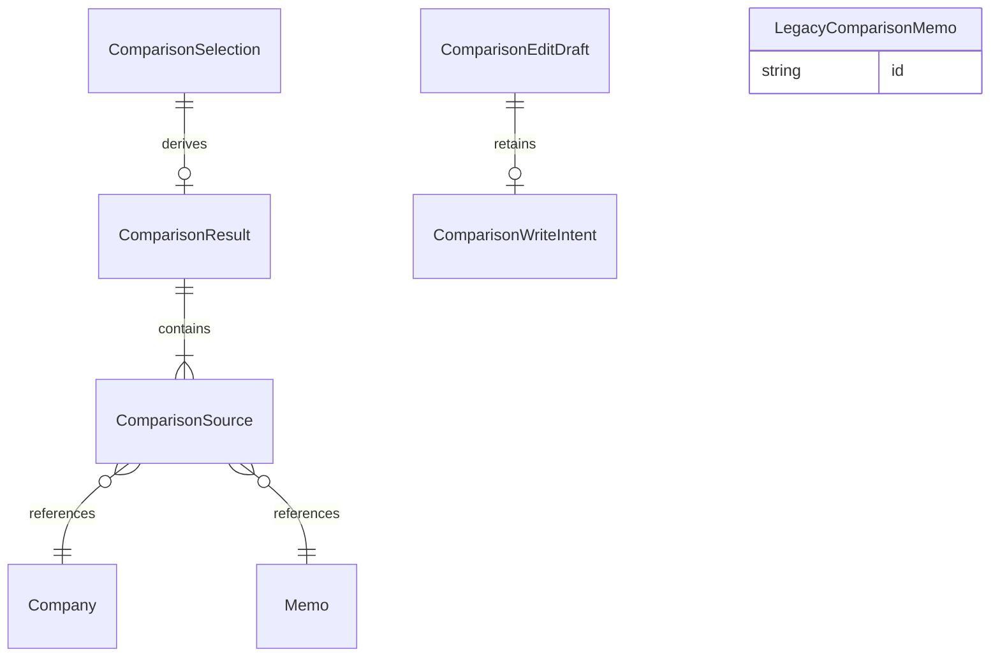

# U3 — 保存企業の比較と対応Markdown

## Scope and Contract Basis

本人が保存企業ごとに1構造化メモを選び、既存7観点・企業共通の志望度・選択メモの比較理由を確認し、対応する比較Markdownを出力する。CompanyComparisonと比較画面を担当し、読取・明示更新はC1/C3/C4を利用する。新しい比較保存ストア・比較用の企業複製・新しい外部処理を作らない。

主担当はUS8.1とUS9.1の比較部分。共同確認は本人・別端末、情報区分、企業志望度、競合、削除参照、構造編集後の再取得。全90ACの設計対応/他Unit担当は[traceability.json](traceability.json)に分け、OKは設計上の対応であり試験合格ではない。

## Models and Derived ER View

データと関係の正本は[entities.md](entities.md)。以下はその関係を表示した派生図。外部Company/Memoの所有者は変更しない。単純ER文の識別子・宣言・多重度を限定文法で書込前に照合した。描画結果の検証とは区別する。

テキスト代替: 一つの選択は同じ世代の現在結果を0〜1つ持ち、有効結果は選択順に1〜20参照を含む。図の参照多重度はready時を示し、loading等では参照0件を許容する。各参照は同じ保存元の企業と所属メモを指す。欄別draftは現在/確定済みの保存意図を保持する。旧ブラウザ記録は新比較と独立している。

## Ordered Workflows

### WF1 — 入口、本人と比較候補

1. 本人の境界を確認し、保護表示前に認証状態を判定する。入口は「保存した企業を比較」と「このブラウザの旧比較」を明確に分け、新比較を初期入口にする。
2. 本人の全保存企業を比較候補として読み、終了状態も候補から勝手に除外しない。通常ボードの表示条件・社数・保存状態は変更しない。
3. 読込中、保存企業0件、取得失敗を分ける。新比較は未選択から始め、旧比較の既存初期選択を新比較へ持ち込まない。
4. 企業ごとに所属メモの概要を読み、既定20/最大100のページと追加取得を区別する。ページ件数を全所属件数と推定しない。構造なしのメモは理由付きで区別し、選択できる構造化メモとして返さない。
5. 同名企業はIDや参照情報で区別し、保存名だけで統合しない。既存単発生成・企業詳細の入口を残す。

### WF2 — 企業と参照メモの選択、比較取得

1. 本人が企業と各社1メモを選ぶ。追加順を保持し、同じ企業のメモ切替はその位置の参照だけを変更する。新選択に合わせた自動メモ統合や生成はしない。
2. 切替で欄別未保存内容を捨てる場合は先に確認し、取消なら旧選択・入力を保つ。送信済み未確定要求は画面を隠しても同じ本人の一時メモリに残し、サーバー取消しを約束しない。
3. 0件なら旧結果を無効にして対象なしを表示し、要求・出力を行わない。1〜20社は許可し、1社なら追加可能と案内する。21社目は保存企業を変更せず選択上限を示す。
4. 選択世代を更新し旧要求を取消し/無効化して、C3へ選択順の企業ID・メモIDを一度だけ渡す。比較参照は読取意味の要求で、自動POST再送や操作記録照会をしない。
5. 返却した全参照の順序・対象・所属・構造・企業版・メモ版を検証する。一つの整合した読取で全選択が有効な場合だけreadyへ。
6. 遅い旧応答は適用しない。失敗・不正・対象不明は結果なし/古い結果と区別して出力を止め、再取得または再選択へ進める。

### WF3 — 比較表と情報区分

1. 保存企業名と参照メモの識別情報・イベント・保存版/更新時点を示す。生成メモ内の企業名を保存企業名へ書き戻さない。
2. strengths、concerns、impressions、emphasizedPoints、idealCandidate、esPoints、questionsの順で既存ラベルの7観点を表示する。
3. 空配列は「未記載」、元の要確認は「要確認」と区別し、欠損を弱点やゼロ評価へ変換しない。本文から項目を再生成しない。
4. 手入力/生成とdummy/openaiを保存値どおり識別し、dummyは検証用/デモと表示する。
5. 採用Webは7観点と別区分にし、内容・URL・取得日と保持されたid/category/confidence/adopted状態を失わない。会社の自由メモと本人の比較理由も説明会の事実に混ぜない。
6. PC/スマホで同じ観点順・選択順・参照データを使う。

### WF4 — 企業志望度と選択メモ理由の明示更新

1. 企業の志望度とメモの理由に別欄・別の保存ボタン・独立した結果を用意する。入力時点では正本を変更しない。
2. 志望度は未設定/未定/高い/中くらい/低い、理由は5000 code points以下の任意文字列とし、空欄をnullへ正規化する。対象欄以外を送信変更しない。
3. 保存クリックで当該企業またはメモの基準版と変更値・operationIdを凍結してC3/C4の更新を依頼する。同欄の二重送信を抑える。他欄の入力と各欄の結果は独立させる。
4. 確定応答だけを保存成功とし、確定ID・版・結果をdraftの寿命へ保持する。再表示・参照往復だけでは新意図を発行しない。
5. 比較全体を無効化して同じ選択をC3で再取得する。保存後に本人がさらに入力した値は保持し、送信snapshotとの差を混ぜない。
6. 一方の保存だけ確定した場合はその結果だけを通知する。確定後の再取得失敗は「保存成功、最新の取得に失敗」とし、再保存を自動実行しない。新しい保存は本人の新しい明示意図で始める。

### WF5 — 拒否、競合、結果不明

1. 入力拒否は対象欄へ安全なエラーと入力保持を示す。旧有効値を成功変更しない。
2. 旧版の競合では旧基準・draftを保持する。最新取得は別領域へ読み、保持入力を捨てずに差を確認する。
3. 本人が最新を基準に編集を続けると明示するまで基準版を書き替えず、自動マージしない。明示確認後の再保存を新しい意図とし、旧凍結要求を変えて流用しない。
4. 応答途絶・書込側の結果未確定はunknown。操作ID照会でcommittedなら確定結果を通知して最新を読む。unknownなら未保存確定とせず同要求・同IDの本人再試行を案内する。
5. 送信中・結果不明・確定状態は一時的な部品の再表示で初期化しない。別アカウントへは表示しない。旧応答から別対象の保存成功を通知しない。
6. 再取得で対象消失ならその対象の更新/出力を停止し、保護上は他所有者との区別を漏らさない。本人の一時入力を勝手に他メモへ付け替えない。

### WF6 — 再取得、削除参照、失効

1. 明示的な再取得と出力前確認で保存変更を検出する。常時配信や別端末変更の即時検出は約束しない。
2. 選択変更、当画面での保存成功、参照の変更/削除が分かった時点で結果を無効化する。古い内容を参考表示する場合も「古い参照、出力不可」と明示する。
3. メモ削除は当該参照、企業削除はその企業と所属参照を再選択対象にする。残存対象だけを黙って完全比較として出力しない。
4. 取得失敗を保存0件にしない。404は対象なし/利用不可として説明し、本人の候補を再取得できる。
5. 401/ログアウト/本人切替では保護結果と古い要求を破棄する。同じ本人にだけ一時入力と未確定要求を戻し、最新を確認してから継続する。旧ブラウザ比較の保護表示も終了する。
6. 再読込・端末終了を越えた一時入力の復旧や、出力後に起きる別端末変更までの禁止は保証しない。

### WF7 — 比較Markdown出力

1. 現選択がreadyで、未保存draft・送信中/結果不明更新がない場合に出力へ進む。未保存なら保存または明示破棄、未確定なら照会を案内し、入力を消して出力しない。
2. 出力クリックで現在の本人・選択世代・表示版を固定し、同じ選択をC3で再取得する。POSTの自動再送はしない。
3. 返却参照が全て有効で、各company.versionとmemo.versionが表示版に一致することを確認する。snapshotVersionだけの差や無関係な保存企業の変化を参照変更へ読み替えない。
4. 全条件と現世代が一致する時だけ、表示と同じ選択順・7観点・保存志望度・理由・出典・識別子/版から一つの.mdを作る。再取得値を別の未確認表示へ黙って入れ替えて出力しない。
5. 版変更はファイルを作らず最新を表示し、「参照が変わりました。内容を確認してもう一度出力してください」と案内する。削除/不正/取得失敗/401もファイルを作らない。
6. 出力確認の待機中に入力・選択・本人が変わったら中止する。書出し完了後はその確認状態を使い回さず、次のクリックで再確認する。
7. テキストは安全な値として扱い、区切り・改行・長文を壊さず、URLを検証する。編集本文から7観点を補わず、Webを別区分で出す。

### WF8 — このブラウザの旧比較

1. 本人確認後、明示的な旧入口で従来の保存形式を読む。「このブラウザの旧比較」であり、サーバーの本人企業との関連付けがないことを示す。
2. 既存id/memo/markdown/interestNote/savedAt/updatedAtを既存の意味で使い、有効な従来の選択・編集・対応出力を維持する。旧の既存端末内編集を、新比較のサーバー明示保存の成功と混同しない。
3. 旧読取の利用不能・不正データ・有効0件を区別する。安全に読めない項目を説明し、表示可能な従来記録も勝手に修復・消去しない。元の永続データを読取だけで書き直さない。
4. 新サーバー比較・企業削除・メモ削除は旧記録へ書き込まない。旧データから新しいCompanyやMemoを推定作成しない。
5. 旧/新を切り替える際も未保存の新比較入力は確認して保持し、古い要求や一方の出力をもう一方へ混ぜない。ログアウト後は旧比較の表示も保護し直す。

## State Machines and Invariants

| 対象 | 主な遷移 | 不変条件 |
|---|---|---|
| 選択/比較 | no-selection → loading → ready、変更/失敗 → stale/invalid/error | readyは現本人・現選択・有効な全参照だけ。0件・失敗は別 |
| 欄別更新 | editing → saving → committed または unknown/rejected/conflict | 送信前に凍結、同一要求再送、各欄独立 |
| 確定後取得 | committed → 読取中 → ready または readback-error | 取得失敗で確定を失敗へ戻さず、新POSTを作らない |
| 競合 | conflict → 最新を別取得 → 明示確認 → 新編集/新保存意図 | draftと旧基準を保持し、自動マージしない |
| 出力 | idle → checking → file作成 または blocked | 全参照の版一致・現世代・入力未確定なしが必要 |
| 失効 | 任意 → unauthenticated | 保護内容と旧応答を隠し、同じ本人にだけ一時状態を戻す |

7観点の順は固定。保存正本の所有者はU1のまま。比較参照の失敗には変更の操作照会を行わない。有限期限・GET1回までの再試行・POST/PATCH自動再送なしは共有契約を引き継ぐ。具体的な境界検査と実測はNFR/コード計画で定める。

## Frontend and Business Scenarios

[frontend-components.md](frontend-components.md)を画面責任の正本とする。PC1366×768/スマホ390×844、幅320/767/768、200%/400%拡大、キーボード・通知・長文・危険文字は承認済み条件として後続の実画面確認へ引き継ぐ。DOM/callbackだけで実ブラウザの受入と称さない。

| シナリオ | 期待する結果 |
|---|---|
| 2社・各複数メモ | 各社1つの選択元と7観点。切替で理由/項目だけ変わり企業志望度は不変 |
| 手入力の本文だけ | 構造化項目なし、勝手に事実化しない |
| 0社/1社/20社/21社 | 対象なし/有効/有効/選択上限、企業登録は制限しない |
| 別端末で構造・志望度・理由を保存 | 明示取得で最新、旧版更新は競合しdraft保持 |
| 片欄成功・他欄拒否/不明 | 成功結果を独立表示、他欄は入力/同一要求を保持 |
| 保存→別表示→復帰 | 同じ対象の確定結果/未確定意図を保持し、再表示だけで新ID要求を作らない |
| 選択後のメモ/企業削除 | 古い参照と出力を無効化、再選択を案内 |
| 出力確認中の版変更/削除/失効 | 成功ファイル0件、最新確認または本人再確認へ |
| 失敗後の遅い旧成功 | 現本人・世代と不一致なら反映しない |
| 旧比較の存在/壊れ/利用不可 | 新保存と混ぜず、移行/削除せず、状態を説明 |
| 記号・HTML・長文・日付 | 値として安全に表示、出典は別、日付のみの保存値を変えない |

## Derived Rules Summary

判断条件の正本は[rules.md](rules.md)。派生した一覧を以下に示す。

| ID | ルール | 根拠 |
|---|---|---|
| BR1.1 | 比較の全読取・更新・出力前確認を本人の境界で行う | FR1.1, FR1.2, FR1.3, NFR1, C1, C3, C4 |
| BR1.2 | 本人・選択・要求世代を越えた結果を適用しない | FR1.3, NFR1, NFR3, C1 |
| BR2.1 | 新比較は選択順を持つ1企業1構造化メモとする | FR8.1, FR8.2, C3, delivery-planning Input and Response Limits |
| BR2.2 | 候補一覧の未取得・空・構造なし・失敗を区別する | FR3.3, FR8.1, FR8.2, C3, C4 |
| BR2.3 | 比較は一つの整合した保存参照全体から作る | FR8.1, FR8.2, NFR2, C3 |
| BR3.1 | 既存7観点を同じ順序・意味で表示する | FR7.1, FR8.1, domain-design CompanyComparison |
| BR3.2 | 本文・欠損・本人の印象を企業事実へ変換しない | FR5.2, FR7.2, FR7.3, FR8.2, NFR4 |
| BR3.3 | 出自と採用Web出典を別区分で保持する | FR5.2, FR7.3, FR9.1, NFR4, C3 |
| BR4.1 | 企業志望度とメモ比較理由を独立した正本へ明示保存する | FR2.3, FR7.2, FR8.1, NFR2, C3 |
| BR4.2 | 更新意図と結果不明を同じ要求・IDで扱う | NFR2, FR2.3, C3, C4 |
| BR4.3 | 競合時は保持入力と最新保存値を並べて確認する | NFR3, FR2.3, FR7.1, C3, C4 |
| BR4.4 | 一時入力と確定結果の寿命を表示部品の再表示から分離する | NFR2, NFR3, C1, C4, refined-mockups C08 |
| BR5.1 | 選択変更・参照変更・削除で古い結果を無効化する | FR6.4, FR8.1, FR8.2, NFR2, C3 |
| BR5.2 | 出力直前に同じ参照を再取得し版を比較する | FR8.3, FR9.1, C3 |
| BR5.3 | 表示と比較Markdownを同じ保存スナップショットから導出する | FR8.3, FR9.1, NFR4, NFR5, C3 |
| BR6.1 | 旧ブラウザ比較と新サーバー比較を別入口・別正本とする | FR8.4, FR9.1, C1, unit-of-work U3 |
| BR7.1 | 主要操作と状態通知をPC・スマホ・キーボードで利用可能にする | FR3.4, NFR5, refined-mockups C01/C06/C08 |

## Scope Exclusions and Carried Limitations

複数メモ統合、本文の自動構造化、比較の採点/順位付け、結果永続化、移行、新しい復習DB連携、一般公開・共有・外部同期を追加しない。

既存Unitに残る競合draft破棄・復元session・削除期限の不備、生成候補の保存後往復による重複保存、native200%操作未確認、既存依存auditは未解消のまま。U3の欄別競合/意図保持は本Unitの設計責任であり、それをU1/U2の修正完了としない。凍結済みの既存成果物やコードをこの設計で変更しない。実Auth/実Supabase/実CI/公開も未確認で、本人担当のVercel作業を待たない。

## Assumptions & Open Questions

None.

新たな本人判断を要する業務条件は、共有C3/C4・Unit・承認済み画面/上限で解決済み。欄別の一時状態保持、未確定中の出力抑制、明示的な版確認はそれらを満たす設計上の具体化。実装の承認ではなく、Code Generation Plan Approvalは別に必要。

## Sources

- [Unit定義](../../../inception/units-generation/unit-of-work.md)、[担当対応](../../../inception/units-generation/unit-of-work-story-map.md)、[要件](../../../inception/requirements-analysis/requirements.md)。
- [ストーリーと90AC](../../../inception/user-stories/stories.md)、[部品と所有者](../../../inception/domain-design/components.md)。
- [共有C1/C3/C4](../../../inception/contract-design/contract-summary.md)、[操作仕様](../../../inception/refined-mockups/interaction-spec.md)、[入力上限・検証条件](../../../inception/delivery-planning/bolt-plan.md)。
- [現時点の引継ぎ](../../../../../../../../docs/session-handoff.md)。実装済みの部品があることを全受入・実環境成功の証明にしない。

