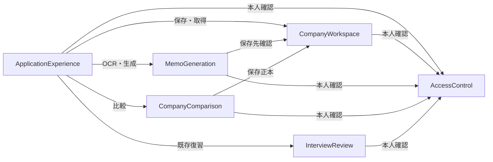

# 企業メモ管理の構成とデータの所有者

## Purpose and Scope

承認済み49要件・18ストーリー・90受入条件と、domain-design-questions.mdの実回答Q1=A、Q2=A、Q3=aから、実装する論理的な役割を6つに分ける。1 Intent = 1リリースBoltを維持する。ここでの部品はコードの責任境界であり、別のサーバー・リリース・実装Unitを意味しない。

項目は所有者・識別子・項目名・参照先までを記す。具体的なデータ型、検証上限、保存スキーマ、API、DB・認証製品、配置方式、タイムアウト値・性能条件は後続で具体化し、実装前の計画確認に含める。未選定の依存先を構築済み・無料・稼働済みと扱わない。

## Component Catalogue

以下のYAMLが責任・所有者・呼出関係の正本。`depends_on` は呼ぶ側、`dependents` は呼ばれる側から同じ関係を表す。

```yaml
components:
  - name: AccessControl
    summary: 本人の識別と利用可否を判定する
    behaviour: >
      保存企業・メモ・新比較だけでなく既存OCR・生成・Web補足・復習も本人確認する。
      未認証・失効・別所有者の保護操作を拒否する。公開healthとログイン入口は保護データを返さない。
    responsibilities:
      - 本人の認証状態と信頼できる利用者識別
      - 各操作が同じアクセス境界を適用するための判定
    depends_on: []
    dependents:
      - component: CompanyWorkspace
        interaction: 読取と書込の本人を確認する
      - component: MemoGeneration
        interaction: 既存生成を本人利用に限定する
      - component: CompanyComparison
        interaction: 比較要求の本人を確認する
      - component: InterviewReview
        interaction: 既存復習を本人利用に限定する
      - component: ApplicationExperience
        interaction: ログイン・ログアウトと保護表示を扱う
    external_dependencies:
      - name: UnselectedIdentityProvider
        kind: third-party-api
        purpose: 認証の依存先。方式・提供条件・本人アカウント準備は後続で選定する
    entities:
      - name: Principal
        identifier: userId
        attributes: [userId, authenticationState]
        references: []
  - name: CompanyWorkspace
    summary: 企業と所属メモを一貫して保存・取得・変更する
    behaviour: >
      サーバー保存企業・メモの唯一の書込元。本人と対象の所有権を検証し、安定IDと所属関係を守る。
      状態と対応中社数を同じ保存状態から求める。古い更新・削除確認を拒否し、重複操作・部分削除を防ぐ。
      企業の志望度は企業共通、比較理由は各メモの本人コメント。本文と構造化項目・原文・Web出典は別に保持する。
    responsibilities:
      - 企業項目・選考状態・企業ごとの志望度の正本
      - メモ本文・構造化項目・訂正OCR・イベント・採用Web出典・比較理由の正本
      - 所有者確認、保存版の照合、同じ操作の再試行、確認対象に一致する削除
      - 状態別一覧と対応中社数の読取
    depends_on:
      - component: AccessControl
        interaction: 本人を識別し各対象の所有者と照合する
        style: sync
    dependents:
      - component: MemoGeneration
        interaction: 保存先企業を指定する生成の対象と所有権を確認する
      - component: CompanyComparison
        interaction: 最新の本人企業と選択メモを読む
      - component: ApplicationExperience
        interaction: 企業・メモの取得と明示した保存・削除を要求する
    external_dependencies:
      - name: UnselectedServerStore
        kind: database
        purpose: 所有者分離・競合検出・一貫した変更を満たす保存先。製品と実現方法は未選定
    entities:
      - name: Company
        identifier: companyId
        attributes: [companyId, ownerId, name, industry, interestLevel, personalNote, selectionStatus, nextSelectionDate, applicationDeadline, officialUrl, version, createdAt, updatedAt]
        references:
          - entity: Principal
            owned_by: AccessControl
            relationship: 保存企業のownerIdは本人のuserIdを指す
      - name: Memo
        identifier: memoId
        attributes: [memoId, ownerId, companyId, origin, markdown, structuredContent, correctedOcr, event, adoptedWebSources, comparisonReason, version, createdAt, updatedAt]
        references:
          - entity: Principal
            owned_by: AccessControl
            relationship: 保存メモのownerIdは本人のuserIdを指す
      - name: WriteOperation
        identifier: operationId
        attributes: [operationId, ownerId, targetIdentity, requestFingerprint, outcome, resultingVersion]
        references:
          - entity: Principal
            owned_by: AccessControl
            relationship: 再試行する操作の所有者を識別する
      - name: DeletionSnapshot
        identifier: confirmationId
        attributes: [confirmationId, ownerId, targetIdentity, targetVersion, affectedMemoIdentities, affectedMemoVersions, displayedMemoCount]
        references:
          - entity: Principal
            owned_by: AccessControl
            relationship: 削除確認を行った本人を識別する
  - name: MemoGeneration
    summary: 一時画像と訂正OCRから検証した生成結果を作る
    behaviour: >
      既存の画像・OCR・Web候補採否・構造化・Markdown生成を利用する。
      生成した企業名で保存先企業を変更せず、不正結果を有効な保存メモにしない。
      元画像は一時表示だけに使い、不要後に参照を解放する。生成結果を保存正本へ直接書き込まない。
    responsibilities:
      - OCR・生成の処理と入力に対する出力検証
      - 紙由来情報・本人の印象・HR強調・質問・ES材料・Web補足の分離
      - 訂正原文と採用Web出典を含む保存候補の受渡し
    depends_on:
      - component: AccessControl
        interaction: 生成処理の本人を確認する
        style: sync
      - component: CompanyWorkspace
        interaction: 指定した保存先企業の存在と本人の所有権を確認する
        style: sync
    dependents:
      - component: ApplicationExperience
        interaction: 訂正OCRと生成結果を確認し保存候補として受け取る
    external_dependencies:
      - name: ExistingOcrLlmWebProviders
        kind: third-party-api
        purpose: 既存の外部OCR・LLM・Web処理。秘密情報はサーバー側、試験はdummy providerを使う
    entities:
      - name: GenerationDraft
        identifier: generationId
        attributes: [generationId, selectedCompanyId, temporaryImageReferences, correctedOcr, event, generatedStructuredContent, generatedMarkdown, adoptedWebSources, providerOrigin, processingState]
        references:
          - entity: Company
            owned_by: CompanyWorkspace
            relationship: 保存先を指定した場合に参照する企業の識別。生成名による付替えをしない
  - name: CompanyComparison
    summary: 保存済み参照メモの7観点と本人の志望度・理由を並べる
    behaviour: >
      本人の各企業に対して選んだ構造化メモを読み、保存済みの比較項目・出典を参照する。
      企業共通の志望度と選択メモの比較理由を区別し、変更はCompanyWorkspaceへ依頼する。
      自由本文を自動構造化せず、欠けた情報を未記載または要確認と示す。旧ブラウザ比較は別の入口と参照元で扱う。
    responsibilities:
      - 比較観点と選択元・保存版を持つ一時的な比較結果
      - 企業・参照メモの選択変更や削除による古い結果の無効化
      - 旧localStorage比較の従来の読取・本人編集・出力を新サーバー比較と分離する
    depends_on:
      - component: AccessControl
        interaction: 新比較の本人を確認する
        style: sync
      - component: CompanyWorkspace
        interaction: 最新参照データを読む。志望度と比較理由の明示更新を依頼する
        style: sync
    dependents:
      - component: ApplicationExperience
        interaction: 比較の参照元・観点・出典と対応する出力内容を表示する
    external_dependencies:
      - name: ExistingBrowserLocalStorage
        kind: other
        purpose: 旧比較データの既存利用のみ。自動移行・自動削除・サーバー送信をしない
    entities:
      - name: ComparisonResult
        identifier: comparisonRequestId
        attributes: [comparisonRequestId, selectedCompanyIdentities, selectedMemoIdentities, sourceVersions, points, companyInterestLevels, memoReasons, adoptedWebSources, resultState]
        references:
          - entity: Company
            owned_by: CompanyWorkspace
            relationship: 比較欄が参照する保存企業
          - entity: Memo
            owned_by: CompanyWorkspace
            relationship: 比較欄が参照する本人の選択メモ
      - name: LegacyComparisonMemo
        identifier: id
        attributes: [id, memo, markdown, interestNote, savedAt, updatedAt]
        references: []
  - name: InterviewReview
    summary: 既存生成結果から面接前復習を作る
    behaviour: >
      本人確認後に既存の復習処理を利用する。原文由来情報と採用Web情報を区別する。
      新しいサーバー保存メモとの接続や復習結果の永続保存を追加しない。
    responsibilities:
      - 既存の復習入力検証・生成・結果検証
      - 既存復習の表示とMarkdown出力に渡す内容
    depends_on:
      - component: AccessControl
        interaction: 既存復習処理の本人を確認する
        style: sync
    dependents:
      - component: ApplicationExperience
        interaction: 既存生成結果から復習し表示・出力する
    external_dependencies:
      - name: ExistingReviewProvider
        kind: third-party-api
        purpose: 既存の復習生成。試験はdummy provider、外部API秘密情報はサーバー側
    entities:
      - name: ReviewResult
        identifier: reviewRequestId
        attributes: [reviewRequestId, sourceGeneratedContent, sourceWebReferences, reviewSections, providerOrigin, resultState]
        references: []
  - name: ApplicationExperience
    summary: 本人の画面・一時編集・確認・対応する出力を扱う
    behaviour: >
      承認済み画面に沿い、登録・状態変更・編集・保存・削除・比較を明示操作として扱う。
      通常6状態と終了企業の任意再表示は読取表示だけを変える。次の選考日を強調し締切・未設定と区別する。
      未保存入力、拒否、結果不明、競合、認証失効を区別し、成功や空データを推測しない。
    responsibilities:
      - ボード・詳細・編集・OCR確認・比較・既存復習の利用導線
      - 未保存編集と一時画像表示・確認・フォーカス・状態通知
      - メモ・比較・既存復習の対応するMarkdownダウンロード
    depends_on:
      - component: AccessControl
        interaction: 本人の入口と失効・ログアウト後の保護表示を扱う
        style: sync
      - component: CompanyWorkspace
        interaction: 保存正本の読取と本人の明示更新を要求する
        style: sync
      - component: MemoGeneration
        interaction: 一時画像・OCR訂正・生成結果を確認する
        style: sync
      - component: CompanyComparison
        interaction: 比較の選択と最新参照結果を表示・出力する
        style: sync
      - component: InterviewReview
        interaction: 既存復習の結果を表示・出力する
        style: sync
    dependents: []
    external_dependencies:
      - name: ExistingBrowserDisplayAndDownloadApis
        kind: other
        purpose: 既存の一時表示・画面操作・ローカルMarkdown出力
    entities:
      - name: EditDraft
        identifier: draftId
        attributes: [draftId, selectedCompanyId, selectedMemoId, draftMarkdown, draftStructuredContent, draftCompanyFields, draftComparisonReason, baselineVersions, dirtyState, saveState]
        references:
          - entity: Company
            owned_by: CompanyWorkspace
            relationship: 編集対象の保存企業
          - entity: Memo
            owned_by: CompanyWorkspace
            relationship: 編集対象の保存メモ
```

## Component Diagram

構文はflowchart LR、ASCIIノードIDと引用ラベル、宣言済み6ノードへの矢印だけを用いて目視確認した。描画ツールによる解析は未実施。



テキスト代替: 画面は5つの処理役割を呼ぶ。企業・メモ管理、生成、比較、既存復習は本人確認を呼ぶ。生成は指定保存先を、比較は参照データと明示更新を企業・メモ管理へ依頼する。生成・比較が独自に保存正本を持つ経路や呼出循環は作らない。

## Component Summary

| Component | Purpose | Depends On | Dependents | Entities Owned |
|---|---|---|---|---|
| AccessControl | 本人識別・利用可否 | なし | CompanyWorkspace, MemoGeneration, CompanyComparison, InterviewReview, ApplicationExperience | Principal |
| CompanyWorkspace | 保存正本・所属・状態・競合・削除 | AccessControl | MemoGeneration, CompanyComparison, ApplicationExperience | Company, Memo, WriteOperation, DeletionSnapshot |
| MemoGeneration | 既存OCRと検証した生成候補 | AccessControl, CompanyWorkspace | ApplicationExperience | GenerationDraft |
| CompanyComparison | 保存メモ比較と旧比較の区別 | AccessControl, CompanyWorkspace | ApplicationExperience | ComparisonResult, LegacyComparisonMemo |
| InterviewReview | 既存復習の処理 | AccessControl | ApplicationExperience | ReviewResult |
| ApplicationExperience | 画面・一時入力・確認・出力 | AccessControl, CompanyWorkspace, MemoGeneration, CompanyComparison, InterviewReview | なし | EditDraft |

## Entity Ownership

| Entity | Owning Component | Identifier | Attributes | References |
|---|---|---|---|---|
| Principal | AccessControl | userId | userId, authenticationState | なし |
| Company | CompanyWorkspace | companyId | ownerId, name, industry, interestLevel, personalNote, selectionStatus, nextSelectionDate, applicationDeadline, officialUrl, version, createdAt, updatedAt | Principal。識別子も属性に含む |
| Memo | CompanyWorkspace | memoId | ownerId, companyId, origin, markdown, structuredContent, correctedOcr, event, adoptedWebSources, comparisonReason, version, createdAt, updatedAt | Principal。companyIdは同じ管理役割のCompanyを指す |
| WriteOperation | CompanyWorkspace | operationId | ownerId, targetIdentity, requestFingerprint, outcome, resultingVersion | Principal。保存・削除の再試行を識別 |
| DeletionSnapshot | CompanyWorkspace | confirmationId | ownerId, targetIdentity, targetVersion, affectedMemoIdentities, affectedMemoVersions, displayedMemoCount | Principal。確認対象と変更検査に使う項目名 |
| GenerationDraft | MemoGeneration | generationId | selectedCompanyId, temporaryImageReferences, correctedOcr, event, generatedStructuredContent, generatedMarkdown, adoptedWebSources, providerOrigin, processingState | Company。一時候補で保存メモではない |
| ComparisonResult | CompanyComparison | comparisonRequestId | selectedCompanyIdentities, selectedMemoIdentities, sourceVersions, points, companyInterestLevels, memoReasons, adoptedWebSources, resultState | Company, Memo。一時的な派生結果 |
| LegacyComparisonMemo | CompanyComparison | id | memo, markdown, interestNote, savedAt, updatedAt | なし。旧ブラウザ形式、サーバー企業IDを推定しない |
| ReviewResult | InterviewReview | reviewRequestId | sourceGeneratedContent, sourceWebReferences, reviewSections, providerOrigin, resultState | なし。新保存メモへの参照を追加しない |
| EditDraft | ApplicationExperience | draftId | selectedCompanyId, selectedMemoId, draftMarkdown, draftStructuredContent, draftCompanyFields, draftComparisonReason, baselineVersions, dirtyState, saveState | Company, Memo。一時入力、保存正本と区別 |

詳細な型・値・制約・関係の多重度は後続のスキーマ設計で定める。WriteOperationとDeletionSnapshotの永続化・署名・期限等の具体方式もここでは決めない。未保存内容や画像を監査記録へ転記しない。

## External Dependencies

| Component | Dependency | Kind | Purpose |
|---|---|---|---|
| AccessControl | UnselectedIdentityProvider | third-party-api | 認証方式の後続選定。本人のみのアカウント準備と公開募集なしを満たす |
| CompanyWorkspace | UnselectedServerStore | database | 永続保存・所有者分離・競合検出・原子的な変更の後続選定 |
| MemoGeneration | ExistingOcrLlmWebProviders | third-party-api | 既存provider境界。原画像の外部保持条件は別途確認 |
| CompanyComparison | ExistingBrowserLocalStorage | other | 従来の旧比較のみ。自動移行・削除なし |
| InterviewReview | ExistingReviewProvider | third-party-api | 既存の復習provider境界 |
| ApplicationExperience | ExistingBrowserDisplayAndDownloadApis | other | 一時表示・手入力・ダウンロード |

DB、認証製品、ブラウザAPI、外部providerは論理コンポーネントの数に含めない。新たなインフラ・外部API実リクエスト・秘密情報は追加していない。

## Rationale

| Component | 別の責任として扱う理由 | 境界の注意 |
|---|---|---|
| AccessControl | 本人の識別と失効は企業情報の変更と別の関心事 | 所有権は本人識別だけで済ませずCompanyWorkspaceで対象を照合 |
| CompanyWorkspace | 企業削除と所属メモ、保存版、社数を一貫して扱う | 企業とメモを別の書込元へ分散しない |
| MemoGeneration | 外部生成と出力検証は保存のライフサイクルと異なる | 誤った生成名・不正結果を保存正本へ直結しない |
| CompanyComparison | 選択メモから作る派生表示であり保存正本とは異なる | 編集は管理役割へ依頼、出力は同じ確認済み参照から作る |
| InterviewReview | 既存機能を保ち、新DB連携を範囲へ混入させない | 今回の保存メモを新たに読み込まない |
| ApplicationExperience | 未保存入力・レスポンシブ表示・確認・出力の関心事 | 入力の保持を保存成功と混同せず、所有者判断をUIだけで代用しない |

### 境界の代替案

- **案A — 企業と所属メモを同じCompanyWorkspaceが所有（提案）**: 削除・保存・再試行と所属関係を一つの責任で検証できる。管理役割は大きくなるが、内部分割は後から変更できる。今回の確認後削除・競合を一貫させる目的に合う。
- **案B — 企業とメモの管理を別コンポーネントへ分割**: 個別の変更は独立しやすいが、企業削除と子メモ変更に跨る調整・契約が増える。単一リリースの今回では調整負担が上回るため採用しない案とする。
- **案C — 生成・保存・比較を一つの機能へ集約**: 初期接続は短いが、外部結果と保存正本・本人コメント・編集状態が混ざりやすい。既存の本文と比較JSONの分離問題を増やすため採用しない案とする。

構成案の最終選択はこの成果物の承認で行う。ADR-001に理由とAlternatives Rejectedを記録する。別サービスへの分割・配置方式はここで選択していない。

## Design Decisions from Answers

### 志望度と比較理由

Q1 Aに従い、Company.interestLevelが企業詳細・新比較の共通正本。比較での志望度更新もCompanyWorkspaceへ依頼する。Memo.comparisonReasonはそのメモに対する本人の比較理由であり、Company.personalNoteや原文事実とは別。

設計の受入例: 同じ企業の参照をメモM1からM2へ切り替えると、7観点と比較理由はM2の保存内容へ変わる。企業志望度は変わらない。企業詳細で志望度を保存後、新比較を再取得すると同じ値となる。M1の理由を修正してもM2の理由・企業自由メモ・構造化された事実を変更しない。旧localStorageの志望度・理由は旧データだけを参照し、同期しない。

### 企業比較の意味

既存comparison.tsの7観点を保持する: 強み・特徴、懸念・気になった点、自分との接点・印象、HR・社員の強調点、求める人物像、ES・面接で使える材料、次に聞きたい質問。選んだ保存メモの構造化項目を並べ、参照企業・メモ・保存版を示す。情報区分を保ち、Web補足と出典は別区分。本文だけの編集で比較用項目を自動再生成しない。不明は未記載／要確認とし、比較結果の欠損を会社の弱点と断定しない。

### 本人確認の範囲

Q2 Aに従い、新保存API、新比較、既存OCR・構造化生成・Web補足・復習の画面とAPIを本人確認の対象とする。未認証でAPIだけ呼ぶ経路も拒否する。ログイン入口・公開health・保護内容を含まない静的資産は区別する。既存機能への導線は本人ログイン後に保持する。認証失効後の遅延応答で私的情報を再表示しない。具体的な認証設定・セッション失効の確認方法は契約・実装計画で定める。

### 規模の設計入力

Q3 aの代表データは架空の100企業・1,000メモ・約10,000字の長文例、50メモが所属する企業の例。登録上限やすべてのメモの最大文字数として扱わない。CompanyWorkspaceは一覧に必要な項目とメモ本文の取得を分け、比較は選択対象を読む責任を持つ。具体的なページング・入力上限・応答時間・測定条件・無料枠での容量確認は後続計画で定める。無料枠適合・性能達成をまだ証明していない。

## Brownfield Integration

既存のUI→HTTP client→API Route→server service→provider、構造検証・Markdown変換を出発点にする。現在のファイルと新しい論理役割は一対一ではなく、必要な変更先は後続Unitとコード計画で確定する。

- BriefingNoteFlowと各stepの生成・編集はMemoGeneration／ApplicationExperienceへ対応。保存候補を受け、本人が保存した時点でCompanyWorkspaceのMemoとして確定する。
- company compareとcomparison.tsの7観点・旧保存はCompanyComparisonへ対応。新サーバー参照は企業IDとメモIDを明示し、旧ブラウザの名前だけでCompanyを作らない。
- 既存InterviewReviewの生成・表示・出力を保つ。保存DBへの新接続や既知不具合の一括修正は含めない。
- body／JSON／OCR／Web出典はそれぞれの用途を維持する。既存schemaの生成企業名は保存対象IDの権限証明にならない。

## Verification and Downstream Work

全18USをtraceability.jsonで6部品へ対応付ける。ドキュメントの構造・依存・参照検査を行い、アプリ動作は実装後の承認済み検証で確認する。

| 後続 | 確定する事項 |
|---|---|
| Units Generation | この部品群の実装Unit・依存順と既存Next.js／Vercelへの配置。1リリースを維持 |
| Contract Design | 本人識別、対象参照、保存・削除・再試行・競合、結果不明、情報区分の正式な受渡し |
| Delivery Planning | 無料条件を満たす依存先・設定・容量・休止時の影響、応答目標・測定条件、TDD・80% line coverage・具体コマンド・手動／公開確認を実装前に承認 |
| 後続の詳細設計 | 完全スキーマ、版と子集合の検査・変更を一貫させる方法、タイムアウト・制限、認証失効・未保存入力保持 |

無料枠・性能・保存先等が決まらないまま実装計画を承認可能としない。必要なら実装前に追加質問で確定する。図や項目一覧の存在をTDD・実保存・セキュリティ・本番成功の証拠にしない。

## Sources

- [Q1]〜[Q3] `domain-design-questions.md` の実際の記入回答。今回の企業比較への会話質問は説明要求として扱い、新しい比較観点の追加指示とは扱わない。
- `../requirements-analysis/requirements.md`、`../user-stories/stories.md`、`../refined-mockups/mockups.md`と`interaction-spec.md` — 承認済みの動作と情報境界、設計に委ねられた点。
- `aidlc/spaces/default/codekb/briefing-note-ai/architecture.md`、同`component-inventory.md` — 既存構造の静的所見。
- `src/lib/comparison.ts` — 既存7観点、旧保存形式、志望度と本人コメント。コードの存在を本番成功と扱わない。
- `../practices-discovery/team-practices.md`、適用project/team規則 — TDD、単一リリース、直列Unit、人間承認・マージ、対象SHA公開確認。

## Assumptions & Open Questions

本人の認証サービス・本人アカウント準備、保存製品と無料枠、完全スキーマ・契約、同じ操作の識別と保持期間、削除の版検査と書込一貫性、失効後復帰、外部OCRの画像保持、長文・件数・ページング・性能条件は後続で具体化する。Q1〜Q3は確認済みだが、上記が検証済み・設定済みという意味ではない。
