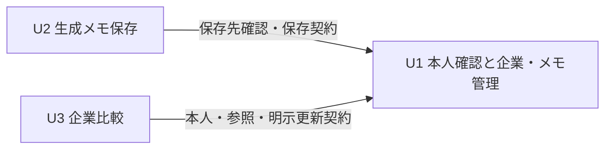

# Unitの依存関係

## Machine-Readable Dependency DAG

```yaml
units:
  - name: u1-company-notes
    kind: service
    depends_on: []
  - name: u2-generated-notes
    kind: service
    depends_on: [u1-company-notes]
  - name: u3-company-comparison
    kind: service
    depends_on: [u1-company-notes]
```

Unit名はunit-of-work.mdのName／Directory、U1〜U3は同じ定義表のUnit IDへ対応する。依存は「左のUnitが右のUnitを必要とする」という向き。U2とU3の直接依存は置かない。YAMLは各Unitを1回だけ宣言し、参照は宣言済みUnit、自己依存と循環はない。

## Dependency Diagram



Mermaidはflowchart LR、宣言済み3ノードと引用ラベルだけを用いて目視で構文確認した。描画パーサによる検証は未実施。テキスト代替: U2とU3はいずれもU1に依存し、U2とU3の間には依存がない。

## Integration Points

| 依存するUnit | 依存先 | 必要な受渡し | 境界・失敗時の期待 |
|---|---|---|---|
| U2 | U1 | 本人の識別、選択企業の確認、検証済み候補の保存と再取得、同じ操作の識別、結果と版 | 生成名は保存先IDの代わりにしない。拒否・結果不明で成功を装わず入力保持。画像バイナリを保存しない |
| U3 | U1 | 本人の企業と選択メモの読取、保存版、企業志望度・メモ別理由の明示更新、参照の存在確認 | 他所有者を返さない。古い変更・削除参照・取得失敗を扱い、表示と出力を同じ参照にする |
| U1の保存／削除とU3 | 同じCompanyWorkspace契約 | 更新・削除確定後の最新取得と参照無効化 | 比較側の無効化はU3で確認。企業・メモの一貫した変更自体はU1が担当 |
| U1の本人確認とU2／U3 | 同じAccessControl契約 | ログイン・失効・ログアウト・未認証の直接要求 | UIだけで保護せず、追加入口でも共通境界を適用する |

ここでは公開APIのパス・型・エラーコード・版の具体方式を発明しない。Contract Designで正式な契約と所有者を定め、各Unitは契約を介して統合する。既存Next.jsアプリ内の共有配置を使い、別のメッセージ基盤や別サービスを追加しない。

## Independent Units and Execution Policy

U1の必要な契約と機能が揃えば、U2とU3は互いの実装に直接依存せず、DAGには複数の有効なトポロジカル順序がある。U3の比較用保存データはU1へ投入した架空fixtureで作れる。U2の外部OCR成功を比較検証の前提にしない。

これは並列実行の許可ではない。今回の実行方針は直列・公式チェックポイント付き。実際の順序と優先順位はDelivery PlanningがDAGを入力として決める。ここでは推奨実装順・critical path・先行する別リリースを定めない。Unit番号や表の列挙順も優先順位の判断ではない。

Classicはskeleton: offなので専用の開始チェックポイントを設けない。U1は本人ログイン→企業登録→手入力メモ保存→別クライアント再取得までを実行できる機能を持つが、その内部確認を独立した本番リリースやskeleton承認に置き換えない。

## Release Boundary

全Unitを同じ1リリースBoltへまとめる。全受入条件と必要な検査・CIを通し、日本語PRを1つ作成、人間のマージ後に実merge SHAの公開を確認する。Unit完了だけでは全ストーリー・全出力・本番確認の完了としない。

## Sources

units-generation-questions.md Q1の実回答、unit-of-work.md、unit-of-work-story-map.md、../domain-design/components.mdとdecisions.md、../requirements-analysis/requirements.md、../user-stories/stories.md、適用team/projectの直列・単一リリース方針。
